# 👻 SoulHunter — Caça de almas pelo transporte público


O **SoulHunter** é uma plataforma gamificada do ecossistema **SoulUp** que une entretenimento e mobilidade urbana: o jogador cumpre missões de hábitos sustentáveis, "caça" almas (fantasmas colecionáveis) pelas estações de metrô de São Paulo e transforma a **essência** acumulada em passagens de transporte público.

Esta é a **Sprint 4** do projeto: o front-end em **React + Vite + TypeScript** deixou de usar dados locais e agora **consome a API REST em Java** (disciplina de *Domain Driven Design Using Java*), com leitura (GET) e escrita (POST, PUT e DELETE) em um banco Oracle.

---

## 📑 Sumário

1. [Como usar (links)](#-como-usar)
2. [Prévia do projeto](#-prévia-do-projeto)
3. [Funcionalidades](#-funcionalidades)
4. [Tecnologias utilizadas](#-tecnologias-utilizadas)
5. [Integração com a API](#-integração-com-a-api)
6. [Rotas da aplicação](#-rotas-da-aplicação)
7. [Tipos TypeScript](#-tipos-typescript)
8. [Estrutura de pastas](#-estrutura-de-pastas)
9. [Responsividade](#-responsividade)
10. [Executar localmente](#-executar-localmente)
11. [Deploy na Vercel](#-deploy-na-vercel)
12. [Identidade visual](#-identidade-visual)
13. [Autores e créditos](#-autores-e-créditos)
14. [Versionamento](#-versionamento)
15. [Contato](#-contato)

---

## 🚀 Como usar

| Recurso | Link |
|---|---|
| 💻 **Repositório no GitHub** | <https://github.com/cearaa/soul_hunter_sprint4> |
| 🌐 **Aplicação publicada na Vercel** | <https://soulhuntersprint4.vercel.app> |
| 🎥 **Vídeo de apresentação (YouTube, até 3 min)** | <https://youtu.be/GKpSchKcyiM> |
| 🔌 **API Java publicada (Render)** | <https://soulhunter-rm571411.onrender.com/soulhunter> |

> ⏳ **Atenção:** a API roda no plano gratuito do Render e hiberna quando fica parada. A **primeira** requisição pode levar até **1 minuto**. A tela mostra um aviso de carregamento e um botão "Tentar de novo" caso falhe.

**Passo a passo para testar a aplicação publicada**

1. Abra a URL da Vercel e vá em **Caçadores** → **Novo caçador** para cadastrar um jogador (POST).
2. Abra o **Dashboard**, escolha o caçador e registre uma **reciclagem** ou um **deslocamento** (POST). A essência e o título mudam na hora.
3. Veja a colocação na página **Ranking** (GET) e o perfil completo em **Caçadores → Ver perfil** (rota dinâmica).
4. Na página **Fantasmas**, capture, edite e liberte almas (POST, PUT e DELETE).

---

## 🖼 Prévia do projeto

| Caçadores | Fantasmas |
|---|---|
| 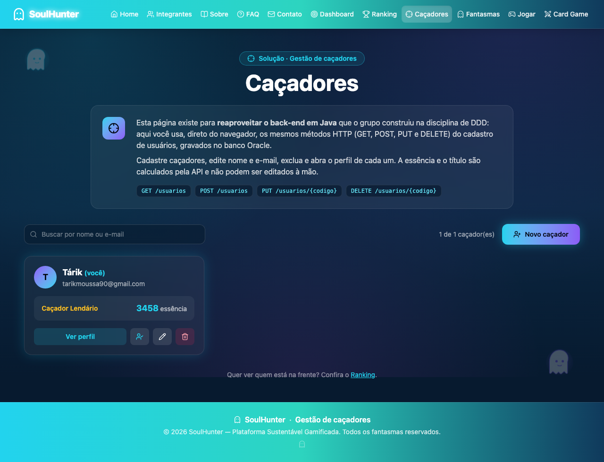 | 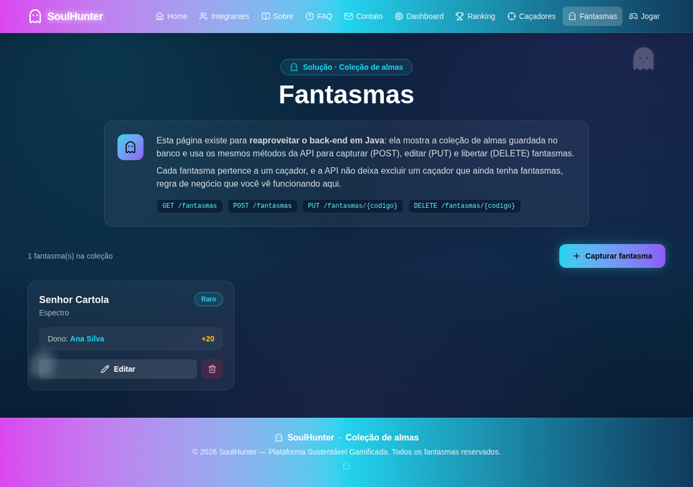 |

| Dashboard | Ranking |
|---|---|
| 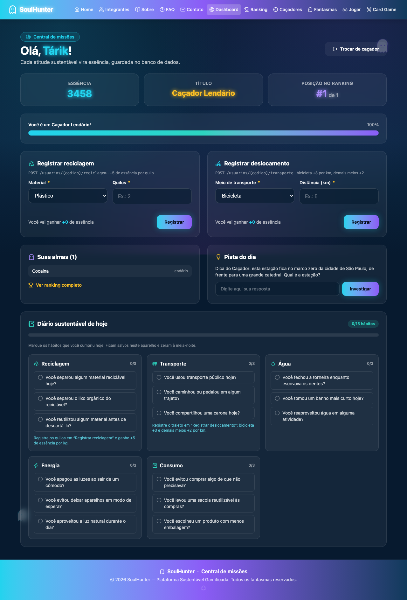 | 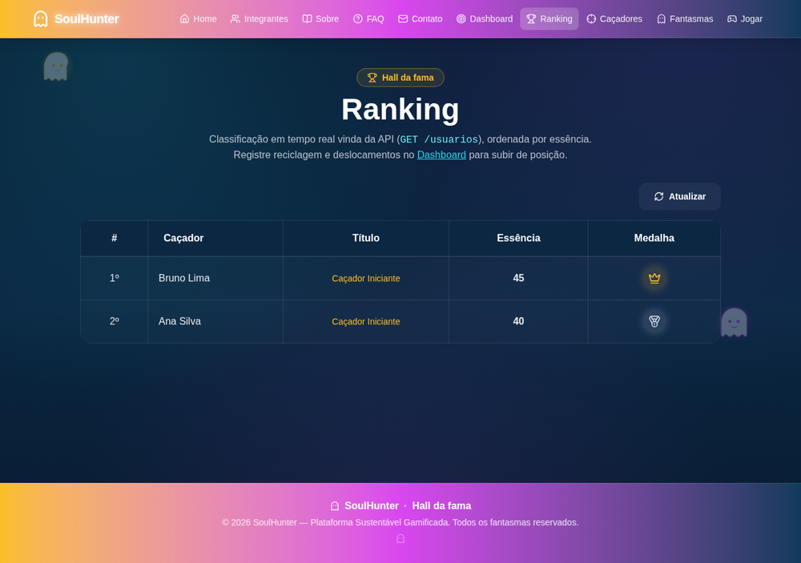 |

| Perfil do caçador (`/cacadores/:id`) | Jogar (BETA) |
|---|---|
| 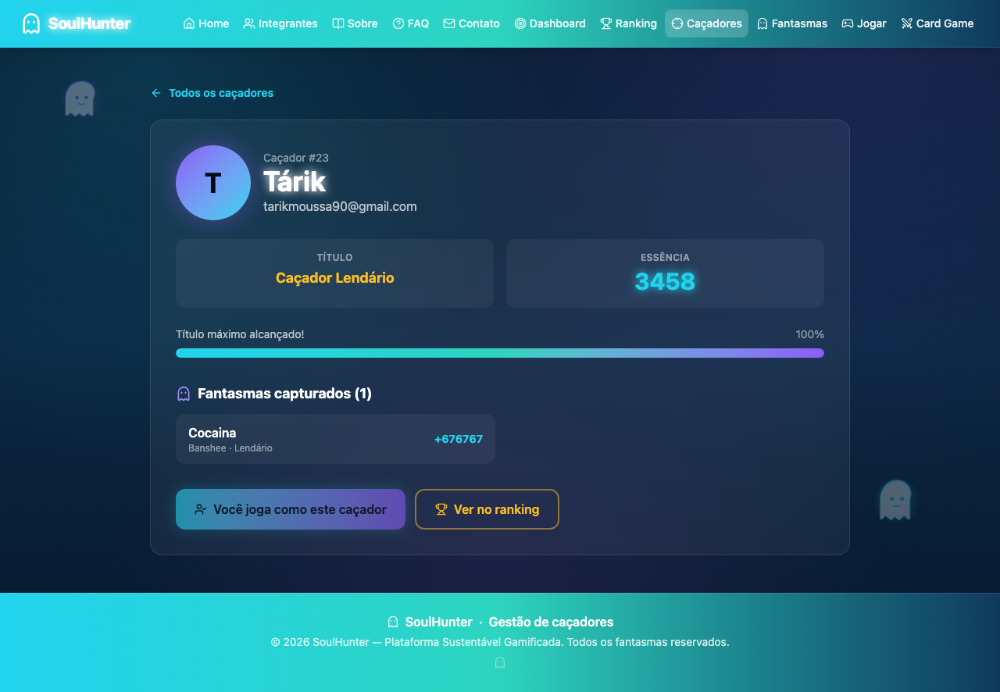 | 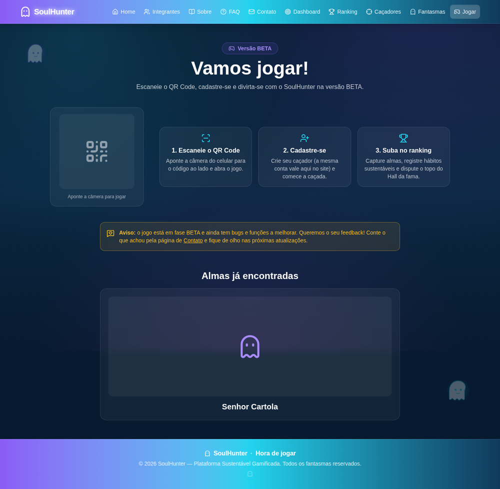 |

| Home | Integrantes |
|---|---|
| 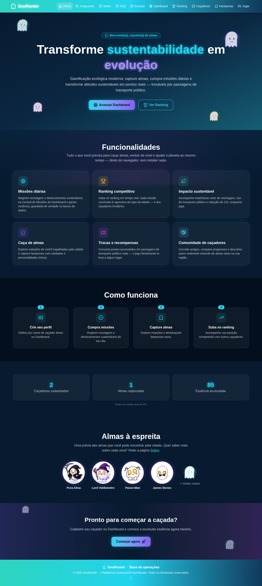 | 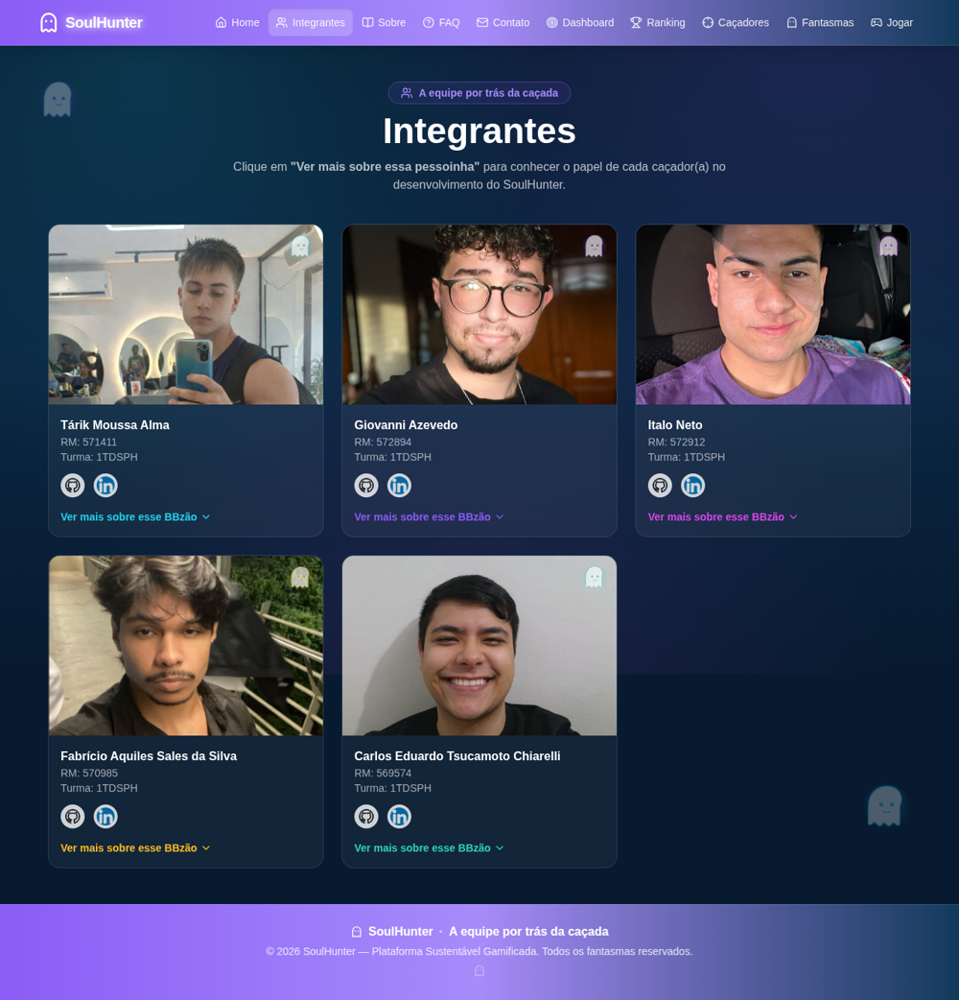 |

| Sobre | FAQ |
|---|---|
| 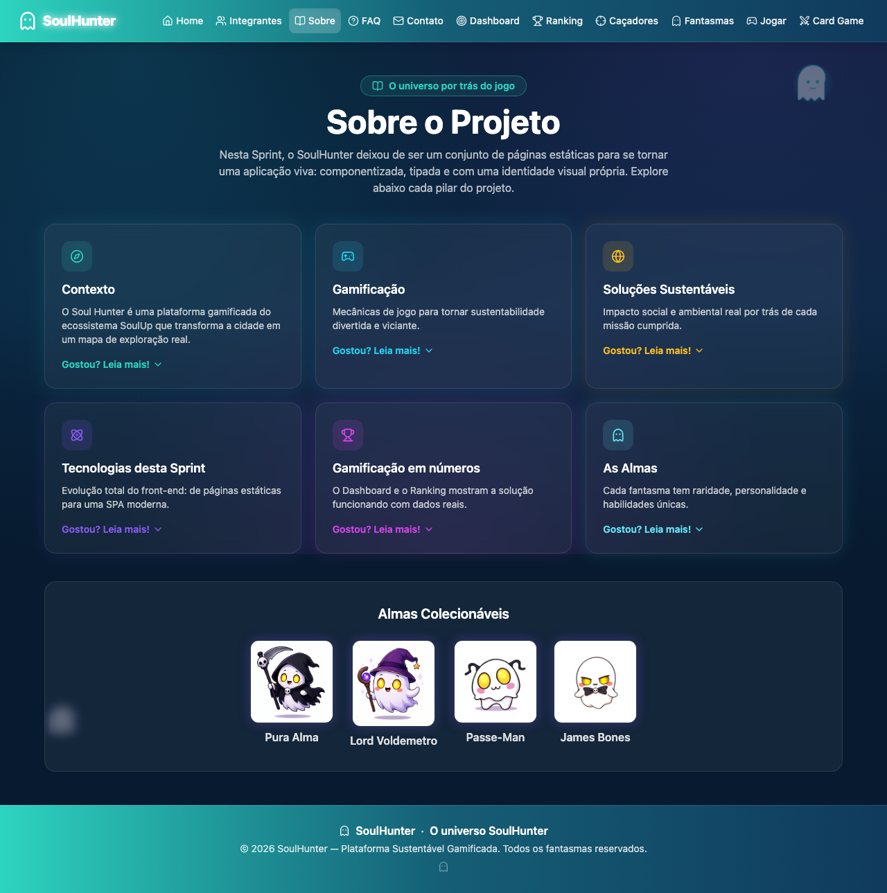 | 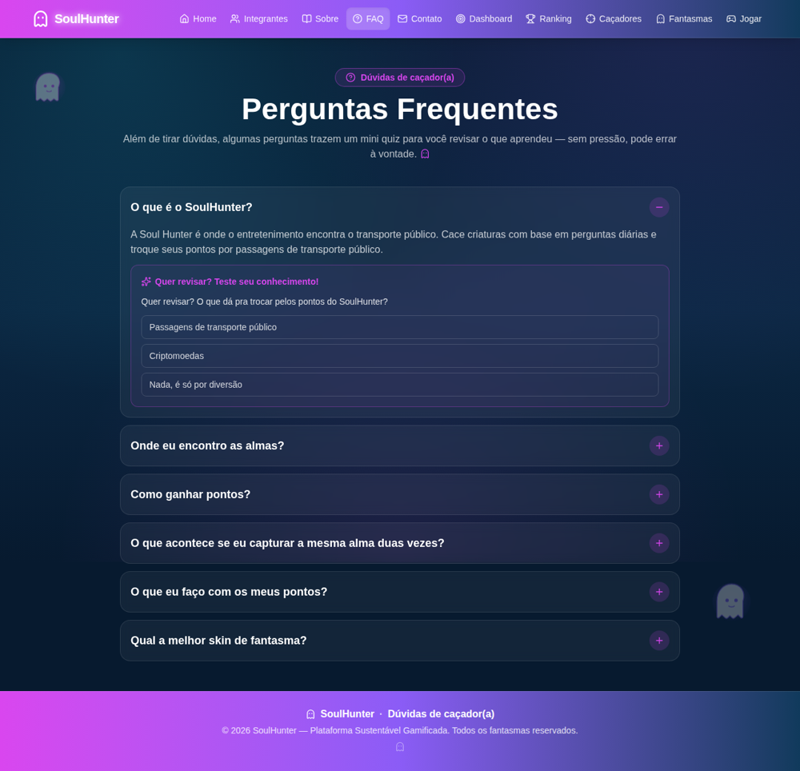 |

**Versão mobile**

<p>
  
  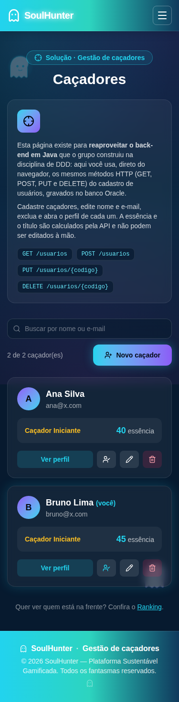
</p>

---

## ✨ Funcionalidades

- **Caçadores** (`/cacadores`): lista, busca, cadastro, edição e exclusão de usuários, com confirmação antes de excluir e mensagens da API.
- **Perfil do caçador** (`/cacadores/:id`): rota dinâmica com título, essência, barra de progresso para o próximo título e fantasmas capturados.
- **Fantasmas** (`/fantasmas`): coleção de almas com criação, edição e exclusão, vinculadas ao caçador dono.
- **Dashboard** (`/dashboard`): escolha do caçador (lembrado no aparelho), registro real de **reciclagem** e **deslocamento**, prévia da essência a ganhar, posição no ranking, pista do dia e diário sustentável com 15 hábitos.
- **Ranking** (`/ranking`): classificação ao vivo por essência, com medalhas e destaque do jogador atual.
- **Card Game** (`/cardgame`): duelo online 1 contra 1 com as cartas de fantasmas. Cria ou entra em uma sala por convite, joga seis duelos e enfrenta o chefe final Nexus NEXT; inclui o catálogo das 37 cartas.
- **Home com números reais**: caçadores cadastrados, almas capturadas e essência acumulada vêm da API.
- **Páginas institucionais**: Home, Integrantes (com rota dinâmica), Sobre, FAQ com mini quiz, Contato com formulário validado e a página **Jogar** (QR Code da versão BETA).
- **Estados de tela** em tudo que usa a API: carregando, erro (com botão de nova tentativa) e resposta vazia.
- **Feedbacks e redirecionamentos personalizados**: código inválido, caçador inexistente e integrante inexistente levam à lista correta com uma mensagem explicando o motivo.

### Regras de negócio (calculadas pela API)

| Ação | Essência |
|---|---|
| Reciclagem | +5 por quilo |
| Deslocamento de bicicleta | +3 por km |
| Outros meios (caminhada, ônibus, metrô, trem) | +2 por km |

Títulos: **Aprendiz de Caçador** (0), **Caçador Iniciante** (30), **Caçador Raro** (60) e **Caçador Lendário** (100).

---

## 🛠 Tecnologias utilizadas

- **React 19** + **TypeScript** + **Vite** (SPA)
- **React Router** (`createBrowserRouter`, rotas estáticas e dinâmicas)
- **Tailwind CSS 4** (estilização e responsividade, sem CSS manual de layout)
- **React Hook Form** (formulários e validações)
- **Lucide React** (ícones)
- **`fetch` nativo** para as requisições HTTP (sem Axios nem bibliotecas externas de requisição)
- **Java + Spring Boot + Oracle** (API da disciplina de DDD, publicada no Render)
- **Git / GitHub (GitFlow)** e **Vercel** (deploy)

Hooks usados: `useState`, `useEffect`, `useReducer`, `useContext`, `useMemo`, `useCallback`, além de hooks próprios (`useApi`, `useCheckinsDiarios`, `useDocumentTitle`).

---

## 🔌 Integração com a API

URL base: `https://soulhunter-rm571411.onrender.com/soulhunter`, configurável pela variável `VITE_API_URL` (veja `.env.example`).

| Método | Endpoint | Onde é usado |
|---|---|---|
| GET | `/usuarios` | Caçadores, Ranking, Dashboard |
| GET | `/usuarios/{codigo}` | Perfil do caçador, Dashboard |
| POST | `/usuarios` | Cadastro de caçador |
| PUT | `/usuarios/{codigo}` | Edição de caçador |
| DELETE | `/usuarios/{codigo}` | Exclusão de caçador |
| GET | `/usuarios/{codigo}/fantasmas` | Perfil e Dashboard |
| POST | `/usuarios/{codigo}/reciclagem` | Dashboard |
| POST | `/usuarios/{codigo}/transporte` | Dashboard |
| GET | `/fantasmas` | Fantasmas |
| POST / PUT / DELETE | `/fantasmas`, `/fantasmas/{codigo}` | Fantasmas |

**Organização da camada de integração**

- `src/services/api.ts`: função única de requisição (fetch), erro padronizado (`ApiError`), tratamento de respostas em texto ou JSON e **fila que executa as chamadas em sequência**, porque o back-end Java usa uma única conexão com o banco.
- `src/services/usuarioService.ts` e `fantasmaService.ts`: uma função por endpoint. **Nenhum componente chama `fetch` diretamente.**
- `src/hooks/useApi.ts`: transforma uma leitura da API em um estado tipado (`carregando`, `erro`, `vazio` ou `ok`).
- `src/components/EstadoView`: renderiza cada estado de forma padronizada.
- `src/services/cardGameService.ts`: chamadas da arena do Card Game (cartas, partidas e jogadas).

**Observações**

- A página de **Contato** continua com envio simulado: a API não possui endpoint de mensagens.
- O **Card Game** usa uma API de partidas separada (`https://soul-hunter-api.vercel.app/api`). Como ela não libera CORS, o front chama `/api/cardgame/...`, que é repassado pelo proxy do Vite no ambiente local e pelo *rewrite* do `vercel.json` no deploy.
- O código do caçador atual fica em `localStorage`; essência e título vêm sempre do banco.

---

## 🧭 Rotas da aplicação

As rotas são declaradas com tipagem em `src/routes/` (`paths.ts` e `index.tsx`).

| Caminho | Tipo | Página |
|---|---|---|
| `/` | estática | Home |
| `/integrantes` | estática | Integrantes |
| `/integrantes/:id` | **dinâmica** | Detalhe do integrante |
| `/sobre` | estática | Sobre |
| `/faq` | estática | FAQ |
| `/contato` | estática | Contato |
| `/dashboard` | estática | Dashboard |
| `/ranking` | estática | Ranking |
| `/cacadores` | estática | Caçadores (solução) |
| `/cacadores/:id` | **dinâmica** | Perfil do caçador (solução) |
| `/fantasmas` | estática | Fantasmas (solução) |
| `/soulhunter` | estática | Jogar (QR Code BETA) |
| `/cardgame` | estática | Card Game (duelo online) |
| `/fantasma` | estática | Easter egg (link no rodapé) |
| `*` | — | Página 404 |

**Redirecionamentos com mensagem**

- `/cacadores/abc` (código inválido) → redireciona para `/cacadores` com aviso explicando o erro.
- `/cacadores/999` (inexistente) → mensagem na tela, contagem de 5 s e redirecionamento com aviso.
- `/integrantes/xyz` (inexistente) → mensagem e redirecionamento para `/integrantes` com aviso.

---

## 🧬 Tipos TypeScript

Os tipos ficam em `src/types/` (`api.ts` e `index.ts`):

- **Tipos básicos e `object`:** `string`, `number`, `boolean` e `Record<string, unknown>` (`ApiConfig`, `CorpoHttp`).
- **Interfaces:** `Usuario`, `Fantasma`, `UsuarioPayload`, `FantasmaPayload`, `ReciclagemPayload`, `TransportePayload`.
- **Union Types:** `TipoMaterial`, `TipoTransporte`, `Raridade`, `MetodoHttp`, `ApiErrorKind` e `Estado<T>` (união discriminada).
- **Intersection Types:** `UsuarioComFantasmas = Usuario & Fantasmas` e `UsuarioComRanking = Usuario & { posicao; medalha }`.

---

## 📂 Estrutura de pastas

```text
.
├── public/                  # favicon
├── docs/screenshots/        # imagens usadas neste README
├── src/
│   ├── assets/img/          # fotos da equipe, almas, ícones
│   ├── components/          # componentes reutilizáveis
│   │   ├── AvisoBanner/     # faixa de feedback (sucesso, erro, info)
│   │   ├── CacadorForm/     # formulário de caçador (POST/PUT)
│   │   ├── FantasmaForm/    # formulário de fantasma (POST/PUT)
│   │   ├── EstadoView/      # carregando / erro / vazio / ok
│   │   ├── PageIntro/       # introdução das páginas da solução
│   │   └── ...              # Header, Footer, Layout, Button, Card, Ghost...
│   ├── context/             # GameContext (caçador atual e toasts)
│   ├── data/                # conteúdo estático (integrantes, FAQ, missões)
│   ├── hooks/               # useApi, useCheckinsDiarios, useDocumentTitle
│   ├── pages/               # Home, Cacadores, Fantasmas, Dashboard, Ranking...
│   ├── routes/              # paths.ts (rotas tipadas) e index.tsx (roteador)
│   ├── services/            # api.ts, usuarioService.ts, fantasmaService.ts, cardGameService.ts
│   ├── theme/               # cores por página e estilos de formulário
│   ├── types/               # interfaces e tipos TypeScript
│   ├── utils/               # ranking, títulos, regras de essência, avisos
│   ├── App.tsx
│   └── main.tsx
├── .env.example             # modelo da variável VITE_API_URL
├── vercel.json              # rewrites: SPA em qualquer rota e proxy da API do Card Game
├── package.json
└── vite.config.ts
```

---

## 📱 Responsividade

Toda a interface usa apenas utilitários responsivos do Tailwind (`sm:`, `md:`, `lg:` e `xl:`), sem media queries manuais.

- **Mobile (até 480 px):** uma coluna, menu hambúrguer, tabelas com rolagem interna.
- **Tablet (768 px):** grades de 2 colunas e formulários lado a lado.
- **Desktop (992 px ou mais):** o breakpoint `lg` foi ajustado para 992 px (`--breakpoint-lg` em `src/index.css`); grades de 3 colunas, painéis em duas colunas e menu completo a partir de `xl` (1280 px).

Testado de 320 a 1536 px sem rolagem horizontal em nenhuma rota.

---

## 💻 Executar localmente

Pré-requisito: **Node.js 20.19+** ou **22.12+**.

```bash
# 1. Clone o repositório
git clone https://github.com/cearaa/soul_hunter_sprint4.git
cd soul_hunter_sprint4

# 2. Instale as dependências
npm install

# 3. (Opcional) configure a URL da API
cp .env.example .env

# 4. Inicie o ambiente de desenvolvimento
npm run dev
```

| Script | O que faz |
|---|---|
| `npm run dev` | servidor de desenvolvimento |
| `npm run build` | verifica os tipos e gera a pasta `dist/` |
| `npm run preview` | serve o build localmente |
| `npm run lint` | roda o ESLint |

Sem `.env`, a aplicação já usa a URL da API publicada no Render.

---

## ▲ Deploy na Vercel

1. Importe o repositório na Vercel (framework **Vite**; build `npm run build`; saída `dist`).
2. Em *Settings → Environment Variables*, crie `VITE_API_URL` com a URL da API (opcional, pois há valor padrão).
3. O arquivo `vercel.json` faz o *rewrite* para `index.html`, permitindo abrir diretamente rotas como `/cacadores/1`.

---

## 🎨 Identidade visual

<p align="center">
  
</p>

| Almas do jogo | Ícones |
|---|---|
|     |   |

Tema noturno com ciano, violeta e magenta (paleta `soul-*` do Tailwind) e fantasmas animados como elemento visual.

---

## 👥 Autores e créditos

Projeto desenvolvido em grupo na **FIAP**, turma **1TDSPH**.

| Foto | Integrante | RM | Turma | Links |
|---|---|---|---|---|
|  | **Tárik Moussa Alma** | 571411 | 1TDSPH | [GitHub](https://github.com/cearaa) · [LinkedIn](https://www.linkedin.com/in/rikk-alma) |
|  | **Giovanni Azevedo** | 572894 | 1TDSPH | [GitHub](https://github.com/GiovanniDEVazevedo) · [LinkedIn](https://www.linkedin.com/in/giovanni-azevedo-760753353/) |
|  | **Italo Neto** | 572912 | 1TDSPH | [GitHub](https://github.com/I-neeto99) · [LinkedIn](https://www.linkedin.com/in/italo-neto-390579345/) |
|  | **Fabrício Aquiles Sales da Silva** | 570985 | 1TDSPH | [GitHub](https://github.com/fabricioaquiles) · [LinkedIn](https://www.linkedin.com/in/fabricioaquiles/) |
|  | **Carlos Eduardo Tsucamoto Chiarelli** | 569574 | 1TDSPH | [GitHub](https://github.com/carlostsucamoto) · [LinkedIn](https://www.linkedin.com/in/carlostsucamoto/) |

**Créditos:** ícones por [Lucide](https://lucide.dev); imagens das almas e logotipo produzidos pela equipe.

---

## 🌿 Versionamento

O projeto segue **GitFlow** (`main`, `develop` e `feature/*`) com commits de todos os integrantes. O guia e a divisão de tarefas estão em [`docs/GITFLOW.md`](docs/GITFLOW.md).

---

## 📬 Contato

- Pela página **Contato** do site (formulário com validação; o envio é simulado).
- Pelo **GitHub** do projeto: abra uma *issue* no repositório.
- Direto com a equipe:

| Integrante | LinkedIn |
|---|---|
| Tárik Moussa Alma | [rikk-alma](https://www.linkedin.com/in/rikk-alma) |
| Giovanni Azevedo | [giovanni-azevedo](https://www.linkedin.com/in/giovanni-azevedo-760753353/) |
| Italo Neto | [italo-neto](https://www.linkedin.com/in/italo-neto-390579345/) |
| Fabrício Aquiles Sales da Silva | [fabricioaquiles](https://www.linkedin.com/in/fabricioaquiles/) |
| Carlos Eduardo Tsucamoto Chiarelli | [carlostsucamoto](https://www.linkedin.com/in/carlostsucamoto/) |
